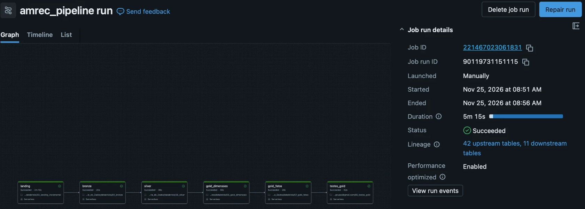
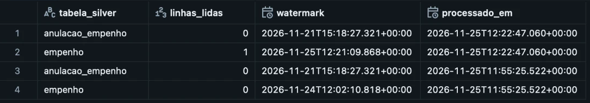

# Lakehouse cloud no Databricks

> Implementação da Issue [#48](https://github.com/02kamk/Trabalho_Final_Engenharia_de_Dados/issues/48).

## Decisão de arquitetura

O projeto iniciou um MVP local com Airflow e MinIO. Para reduzir dependência da máquina pessoal e permitir a continuidade do trabalho em cloud, a arquitetura do Lakehouse está sendo migrada para o Databricks Free Edition.

O MinIO local não está integrado ao Databricks. Ele permanece temporariamente como evidência do MVP anterior e não deve ser removido até a homologação completa da arquitetura cloud pelo grupo e pelo professor.

## Fluxo

```text
Neon PostgreSQL
  ↓ catálogo federado
neon_origem_catalog.origem
  ↓ ingestão CSV bruto
Volume workspace.amrec.landing
  ↓ Delta Lake
workspace.amrec_bronze
  ↓ Delta Lake
workspace.amrec_silver
  ↓ Delta Lake
workspace.amrec_gold
```

## Conexão com a origem

No Databricks foi criada a conexão `neon_origem`, do tipo PostgreSQL, e o catálogo federado `neon_origem_catalog`. A origem é consultada pelo caminho `neon_origem_catalog.origem.municipio`.

A autenticação foi validada com uma consulta que retornou os 12 municípios. As credenciais ficam na conexão governada do Databricks; não devem ser incluídas em notebooks, arquivos versionados ou na documentação.

## Landing

Foi criado o Volume `workspace.amrec.landing`. A carga-piloto leu `origem.municipio` do Neon e gravou um CSV bruto no caminho:

```text
/Volumes/workspace/amrec/landing/municipio/run_id=<identificador>
```

A leitura do arquivo após a gravação confirmou os mesmos 12 registros da origem.

## Notebooks

| Camada | Notebook | Destino |
| --- | --- | --- |
| Landing | `databricks/03_landing_incremental.py` | Volume `workspace.amrec.landing` (controle `workspace.amrec.controle_landing`) |
| Bronze | `databricks/04_bronze.py` | `workspace.amrec_bronze` (controle `workspace.amrec.controle_bronze`) |
| Silver | `databricks/05_silver.py` | `workspace.amrec_silver` (controle `workspace.amrec.controle_silver`) |
| Gold | `databricks/06_gold_dimensoes.py` e `databricks/07_gold_fatos.py` | `workspace.amrec_gold` (controle `workspace.amrec.controle_gold`); ver [Camada Gold](gold.md) |
| Testes | `databricks/08_testes_gold.py` | Só leitura; confere as camadas e a Gold (ver [Testes automatizados](gold.md#testes-automatizados)) |

## Orquestração com Databricks Jobs

> Implementação da Issue [#19](https://github.com/02kamk/Trabalho_Final_Engenharia_de_Dados/issues/19).
> Substitui a orquestração pelo Airflow do MVP local.

O Job `amrec_pipeline` roda o pipeline inteiro, em ordem, uma vez por dia. Cada notebook é uma tarefa, e cada
tarefa só começa se a anterior terminou com sucesso. Como os testes da Gold (`08`) vêm antes do dashboard, o
dashboard só é atualizado com dados que passaram nos testes.

```text
landing → bronze → silver → gold_dimensoes → gold_fatos → testes_gold → dashboard
```

| Tarefa | Tipo | O que roda | Depende de |
| --- | --- | --- | --- |
| `landing` | Notebook | `03_landing_incremental` | — |
| `bronze` | Notebook | `04_bronze` | `landing` |
| `silver` | Notebook | `05_silver` | `bronze` |
| `gold_dimensoes` | Notebook | `06_gold_dimensoes` | `silver` |
| `gold_fatos` | Notebook | `07_gold_fatos` | `gold_dimensoes` |
| `testes_gold` | Notebook | `08_testes_gold` | `gold_fatos` |
| `dashboard` | Dashboard | Dashboard da issue [#22](https://github.com/02kamk/Trabalho_Final_Engenharia_de_Dados/issues/22), publicado | `testes_gold` |

Os notebooks `01` e `02` ficam fora do Job: foram o piloto e o teste de Delta da migração.

### Configuração

| Configuração | Valor | Motivo |
| --- | --- | --- |
| Computação | Serverless | É a única opção no Free Edition |
| Agendamento | Todo dia às 06:00, fuso de Brasília | A origem muda pouco; uma execução por dia basta, e a carga incremental lê só o que mudou |
| Execuções simultâneas | 1 (o padrão) | Duas execuções ao mesmo tempo leriam e gravariam os mesmos watermarks |
| Notificação | E-mail em caso de falha | Uma tarefa que falha interrompe as seguintes, e alguém precisa olhar |
| Novas tentativas | Nenhuma | Uma falha indica um problema (por exemplo, um teste da Gold), e repetir sozinho não resolve. Depois de corrigir, basta rodar o Job de novo: cada camada só grava o controle depois da carga, e a Silver e a Gold usam `MERGE`, então nada é duplicado nelas |
| SQL warehouse da tarefa `dashboard` | Serverless Starter Warehouse | A tarefa de dashboard exige um warehouse serverless ou pro |

Limites do Free Edition que afetam o Job: no máximo 5 tarefas de Job rodando ao mesmo tempo na conta (este Job
roda uma por vez), uma cota diária de uso da computação serverless (se ela estourar, a computação é desligada
pelo resto do dia) e um único SQL warehouse, de tamanho 2X-Small. No Neon, cada execução incremental transfere
pouco, mas convém pausar o agendamento depois da avaliação para não gastar a cota mensal de transferência (ver
[Banco de origem](banco.md)).

### Como criar o Job

1. No menu lateral, abra **Jobs & Pipelines** → **Create** → **Job** e troque o nome do Job para `amrec_pipeline`.
2. Na primeira tarefa, preencha **Task name** `landing`, **Type** `Notebook`, **Source** `Workspace`, **Path** com
   o notebook `03_landing_incremental` e **Compute** `Serverless`. Clique em **Create task**.
3. Clique em **Add task** → **Notebook** e crie a tarefa `bronze` com o `04_bronze`, conferindo que
   **Depends on** é `landing`. Repita para `silver`, `gold_dimensoes`, `gold_fatos` e `testes_gold`, cada uma
   dependendo da anterior.
4. Quando o dashboard da #22 estiver publicado, clique em **Add task** → **Dashboard**, preencha **Task name**
   `dashboard`, escolha o dashboard e o **SQL warehouse** `Serverless Starter Warehouse` e confira que
   **Depends on** é `testes_gold`.
5. No painel **Job details**, à direita, em **Schedules & Triggers**, clique em **Add trigger**, escolha
   **Scheduled** e configure todo dia às 06:00 no fuso de Brasília.
6. Ainda no **Job details**, em **Job notifications**, clique em **Edit notifications** → **Add notification**,
   escolha **Email address**, marque **Failure** e salve.
7. Mantenha as execuções simultâneas em 1 (em **Advanced settings**, já é o padrão).

### Teste do Job

É o mesmo teste da #18, agora com o pipeline inteiro rodando pelo Job.

1. No Neon, altere um empenho. A Gold não usa o `historico`, então os números não mudam:

    ```sql
    UPDATE origem.empenho SET historico = historico || ' ' WHERE id_empenho = 2;
    ```

2. No Job, clique em **Run now** e espere todas as tarefas ficarem verdes.
3. Confira a Gold:

    ```sql
    SELECT id_empenho, _processado_gold_em
    FROM workspace.amrec_gold.fato_empenho
    WHERE id_empenho = 2;

    SELECT tabela_silver, linhas_lidas, watermark, processado_em
    FROM workspace.amrec.controle_gold
    ORDER BY processado_em DESC
    LIMIT 2;
    ```

    O `_processado_gold_em` do empenho 2 tem que ser o horário dessa execução, e a `controle_gold` tem que
    mostrar 1 linha lida de `empenho` e 0 de `anulacao_empenho`.

4. Clique em **Run now** de novo, sem alterar a origem. Todas as tarefas têm que terminar verdes, com "nada
   novo" na Landing, na Bronze e na Silver e 0 empenho recalculado no `07`: rodar o Job de novo não muda a Gold.

### Resultados no Databricks

O Job foi criado no Databricks Free Edition em 25/11/2026, com o agendamento diário às 06:00
(America/Sao_Paulo) e o aviso de falha por e-mail. Enquanto o PR não é aprovado, a tarefa `testes_gold` aponta
para uma cópia do `08_testes_gold` na pasta do usuário, fora da Git folder.

A primeira execução manual terminou com sucesso em 5m 15s, com as 6 tarefas verdes:

| Tarefa | Duração |
| --- | --- |
| `landing` | 2m 10s |
| `bronze` | 20s |
| `silver` | 39s |
| `gold_dimensoes` | 40s |
| `gold_fatos` | 29s |
| `testes_gold` | 52s |

A `landing` é a tarefa mais lenta porque consulta as 15 tabelas do Neon pelo catálogo federado, mesmo quando não
há novidade. Antes dessa execução, o agendamento já tinha rodado o Job sozinho (*By scheduler*), também com
sucesso, em 5m 6s.



#### Teste do Job

Depois da execução manual sem mudanças, o `UPDATE` no empenho 2 foi feito no Neon e o Job foi rodado de novo. A
`controle_gold` mostra as duas execuções (horários em UTC):

| Execução | Tabela da Silver | Linhas lidas | Watermark |
| --- | --- | --- | --- |
| 11:55, sem mudança na origem | `empenho` | 0 | 2026-11-24 12:02 (sem mudança) |
| 11:55, sem mudança na origem | `anulacao_empenho` | 0 | 2026-11-21 15:18 (sem mudança) |
| 12:22, depois do `UPDATE` | `empenho` | 1 | 2026-11-25 12:21 (avançou) |
| 12:22, depois do `UPDATE` | `anulacao_empenho` | 0 | 2026-11-21 15:18 (sem mudança) |

Sem mudança na origem, o Job não leu nada da Silver. Depois do `UPDATE`, leu só o empenho alterado: a mudança
passou pela Landing, pela Bronze, pela Silver e chegou à Gold numa única execução do Job, e os testes da Gold
passaram nas duas execuções.



## Próximas etapas

- Gerar o `elemento_grupo.csv` definitivo a partir dos brutos do Betha (ver [Camada Gold](gold.md)).
- Montar o dashboard a partir das tabelas `agg_` da Gold.
- Adicionar a tarefa `dashboard` ao Job quando o dashboard da #22 for publicado.
- Validar a arquitetura cloud com o grupo e o professor antes de descontinuar o MVP local.