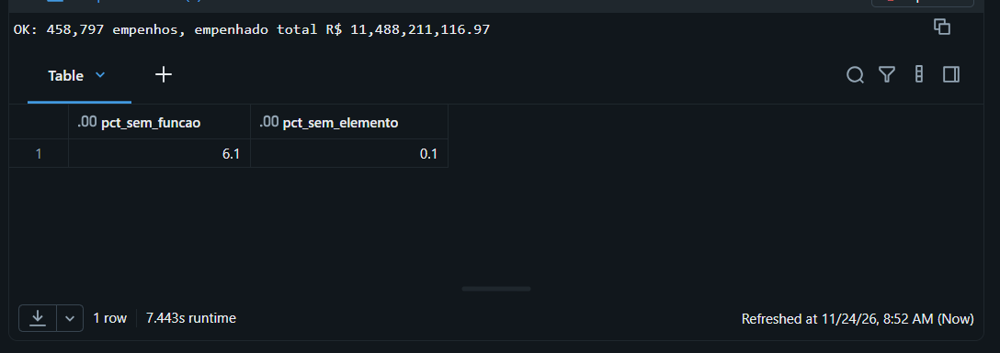
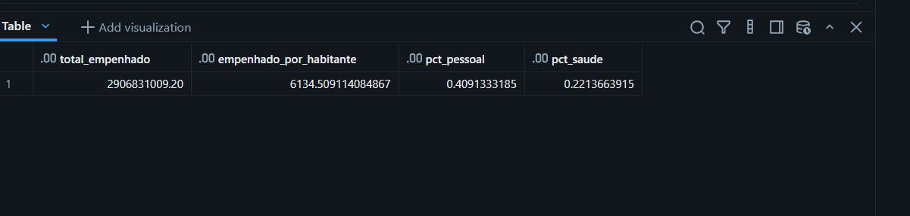
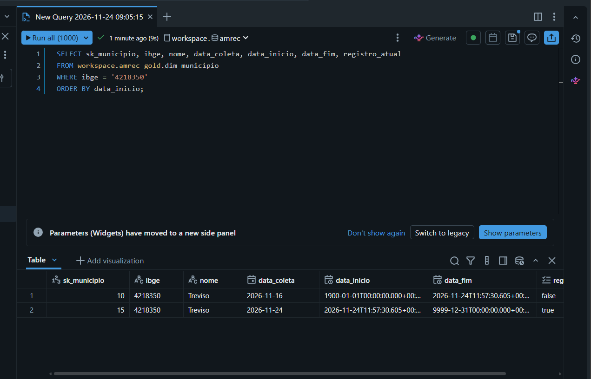
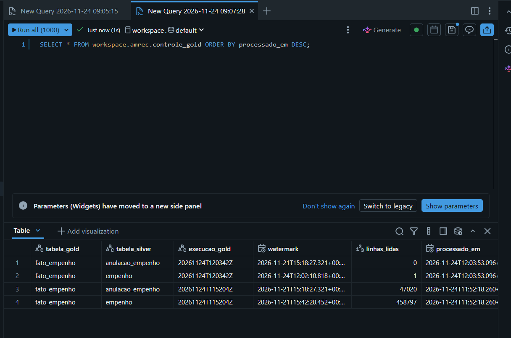
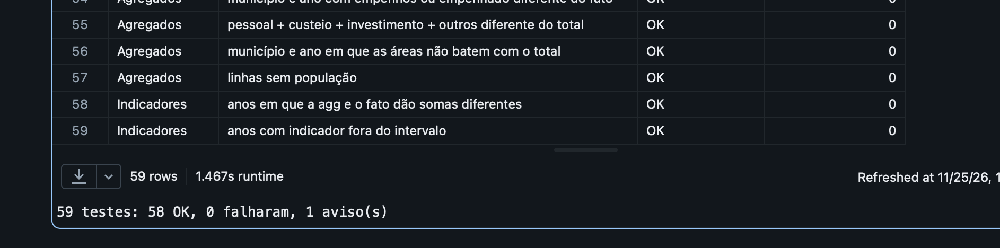

# Camada Gold

> Issues [#16](https://github.com/02kamk/Trabalho_Final_Engenharia_de_Dados/issues/16) (modelagem dimensional),
> [#17](https://github.com/02kamk/Trabalho_Final_Engenharia_de_Dados/issues/17) (dimensões SCD tipo 2) e
> [#18](https://github.com/02kamk/Trabalho_Final_Engenharia_de_Dados/issues/18) (carga incremental dos fatos).
> As fórmulas dos indicadores atendem à [#20](https://github.com/02kamk/Trabalho_Final_Engenharia_de_Dados/issues/20),
> e os testes automatizados, à [#55](https://github.com/02kamk/Trabalho_Final_Engenharia_de_Dados/issues/55).

A Gold fica no schema `workspace.amrec_gold` e é gerada por dois notebooks, que rodam depois da Silver:

| Ordem | Notebook | O que faz |
| --- | --- | --- |
| 1 | `databricks/06_gold_dimensoes.py` | Dimensões (SCD tipo 2) e `dim_data` |
| 2 | `databricks/07_gold_fatos.py` | `fato_empenho` (incremental), `fato_populacao` e as tabelas do dashboard |

Os dois leem arquivos de referência do Volume `/Volumes/workspace/amrec/referencia/`, que são cópias de
`databricks/referencia/`:

| Arquivo | Conteúdo |
| --- | --- |
| `populacao_municipio.csv` | População do IBGE por município e ano (`ibge, ano, populacao, fonte`) |
| `elemento_grupo.csv` | Grupo de natureza de despesa de cada elemento, gerado por `scripts/elemento_grupo.py` |

## Modelo dimensional

O modelo é uma estrela centrada no empenho. Os indicadores do grupo são todos sobre o valor empenhado, por
isso liquidação, pagamento, retenção, documento fiscal, item, diária e extraorçamentário ficam fora da Gold
por enquanto.

```text
                      dim_data
                  (sk_data = yyyymmdd)
                          │
   dim_municipio ──── fato_empenho ──── dim_funcao
   (SCD2, ibge)      (1 linha por      (SCD2, codigo; área)
         │            empenho)
         │                │
   fato_populacao   dim_elemento_despesa
 (município × ano)  (SCD2, codigo; grupo)
```

| Tabela | Grão | Chaves e colunas | Carga |
| --- | --- | --- | --- |
| `fato_empenho` | um empenho | `id_empenho`, `sk_data`, `sk_municipio`, `sk_funcao`, `sk_elemento`, `ano`, `entidade`, `numero`, `elemento_inferido`, `valor_original`, `valor_anulado`, `valor_empenhado`, `_processado_gold_em` | incremental (MERGE por `id_empenho`) |
| `fato_populacao` | município × ano | `sk_municipio`, `ano`, `populacao`, `fonte` | recriada do CSV |
| `dim_municipio` | versão de um município | `sk_municipio`, `ibge`, `nome`, `fonte`, `data_coleta` + colunas SCD2 | SCD tipo 2 |
| `dim_funcao` | versão de uma função | `sk_funcao`, `codigo`, `nome`, `area` + colunas SCD2 | SCD tipo 2 |
| `dim_elemento_despesa` | versão de um elemento | `sk_elemento`, `codigo`, `nome`, `grupo_despesa` + colunas SCD2 | SCD tipo 2 |
| `dim_data` | dia (2023 a 2026) | `sk_data`, `data`, `ano`, `trimestre`, `mes`, `ano_mes` | recriada |
| `agg_empenhado_municipio_ano` | município × ano | `populacao`, `empenhos`, `empenhado_total`, `_pessoal`, `_custeio`, `_investimento`, `_outros_grupos`, `_com_funcao`, `_saude` | recriada |
| `agg_empenhado_area` | município × ano × área | `area`, `empenhado`, `populacao` | recriada |

As duas tabelas `agg_` existem para o dashboard. Nelas a população aparece **uma vez por município e ano**
(ou por município, ano e área). Se ela fosse repetida em cada empenho, a soma no dashboard multiplicaria a
população e o valor por habitante sairia errado.

## Dimensões com SCD tipo 2

Cada dimensão tem as colunas:

| Coluna | Significado |
| --- | --- |
| `sk_*` | Chave substituta (coluna de identidade do Delta, `GENERATED BY DEFAULT`) |
| `data_inicio` | Início da validade da versão. A primeira versão de cada chave vale desde 1900-01-01, para que empenhos anteriores à primeira carga encontrem uma versão |
| `data_fim` | Fim da validade. A versão atual tem 9999-12-31 |
| `registro_atual` | Verdadeiro só na versão atual |
| `hash_atributos` | SHA-256 dos atributos rastreados, usado para detectar mudança |

A cada execução, o `06` compara a Silver com a versão atual de cada chave (as dimensões têm 12, 28 e 50
linhas, então a comparação é feita sobre a Silver inteira). Quando o hash muda, um único `MERGE` do Delta:

1. fecha a versão atual (`data_fim` = `atualizado_em` da origem, `registro_atual` = falso);
2. insere a nova versão, com `data_inicio` = `atualizado_em` da origem.

Isso segue o padrão de *staged updates* do Delta Lake: as linhas alteradas entram duas vezes no MERGE, uma
com a chave (para fechar a versão antiga) e outra com a chave nula (para não casar com nada e ser inserida).

**Membro desconhecido:** `dim_funcao` e `dim_elemento_despesa` têm a linha `sk = -1`. Ela é usada pelos
empenhos sem função (todo o Atende.net) ou sem elemento.

O fato aponta para a versão da dimensão **válida na data de emissão do empenho**.

O fim do `06` confere que cada chave tem exatamente uma versão atual e que as versões de uma chave não se
sobrepõem no tempo; se não, a execução para com erro.

## Carga incremental do fato

Um empenho precisa ser recalculado quando ele mesmo muda ou quando recebe uma anulação. A tabela
`workspace.amrec.controle_gold` guarda, para cada tabela da Silver lida, o maior `_processado_silver_em` já
aplicado (o *watermark*):

| Coluna | Significado |
| --- | --- |
| `tabela_gold` | `fato_empenho` |
| `tabela_silver` | `empenho` ou `anulacao_empenho` |
| `execucao_gold` | Identificador da execução (UTC) |
| `watermark` | Maior `_processado_silver_em` lido |
| `linhas_lidas` | Linhas da Silver lidas nesta execução |
| `processado_em` | Momento da gravação |

A cada execução, o `07`:

1. lê as linhas de `empenho` e `anulacao_empenho` com `_processado_silver_em` maior que o watermark (todas, na
   primeira execução);
2. junta os `id_empenho` afetados e recalcula só esses empenhos, somando todas as anulações de cada um;
3. faz `MERGE` no `fato_empenho` por `id_empenho`;
4. grava o novo watermark em `controle_gold`. O controle só é gravado depois do MERGE: se algo falhar antes,
   a próxima execução relê as mesmas linhas.

As tabelas `fato_populacao`, `agg_empenhado_municipio_ano` e `agg_empenhado_area` são pequenas e são recriadas
a cada execução a partir do fato inteiro.

O fim do `07` confere que o fato tem o mesmo número de empenhos e o mesmo valor original da Silver, que nenhum
empenho ficou sem município, que as tabelas `agg_` somam o mesmo empenhado que o fato e que todo município e
ano tem população. Se algo não bater, a execução para com erro.

## Regras de negócio

### Empenhado

**Empenhado = valor original do empenho − soma das anulações** (`anulacao_empenho`). As anulações só são
publicadas pelos municípios que usam o Betha; no Atende.net o empenhado é o valor original.

### Grupo de despesa (pessoal, custeio e investimento)

A origem guarda só o elemento de despesa (2 dígitos). O grupo de natureza de despesa é o 2º dígito do
`mascaraElemento` do Betha, que o tratamento descartou. Por isso a Gold usa um mapeamento elemento → grupo,
gerado por `scripts/elemento_grupo.py` a partir dos brutos do Betha (`dados/brutos/amrec/*/execucao_detalhada.jsonl`):
para cada elemento, o script escolhe o grupo que concentra mais valor empenhado e marca como `ambiguo` o elemento
em que esse grupo cobre menos de 95% dos empenhos ou do valor.

| Grupo | Rótulo na Gold |
| --- | --- |
| 1 — Pessoal e encargos sociais | Pessoal |
| 3 — Outras despesas correntes | Custeio |
| 4 — Investimentos | Investimento |
| 2 (juros), 5 (inversões), 6 (amortização) e sem elemento | Outros |

!!! warning "Mapeamento provisório"
    O `elemento_grupo.csv` versionado é provisório: foi montado pela Portaria Interministerial 163/2001 e
    contém só os elementos inequívocos. Elementos como 41, 42, 70, 91 e 92 ficam em "Outros" até que o
    arquivo seja gerado com `python scripts/elemento_grupo.py` por quem tem os brutos do Betha.

### Área

A área vem do código nacional da função (Portaria MOG 42/1999):

| Função | Área |
| --- | --- |
| 10 | Saúde |
| 12 | Educação |
| 15 | Urbanismo |
| 4 | Administração |
| demais | Outras |
| sem função | Não informada |

O Atende.net (Treviso, 4218350, e Morro da Fumaça, 4211207) não publica a função, então todos os empenhos
desses municípios ficam em "Não informada".

### População

A população vem do IBGE (SIDRA, tabela 6579, estimativas de 2024 a 2026). O IBGE não publicou estimativa para
2023, então 2023 usa o Censo 2022. É um dado externo pequeno (48 linhas); por isso entra direto na Gold, sem
passar pelo banco de origem.

## Indicadores

Todos usam `agg_empenhado_municipio_ano`, filtrada pelo ano escolhido (padrão: 2025, porque 2026 é parcial).

| Indicador | Fórmula |
| --- | --- |
| Total empenhado | `SUM(empenhado_total)` |
| Empenhado por habitante | `SUM(empenhado_total) / SUM(populacao)` |
| % do empenhado com pessoal | `SUM(empenhado_pessoal) / SUM(empenhado_total)` |
| % do empenhado com saúde | `SUM(empenhado_saude) / SUM(empenhado_com_funcao)` |

O % com saúde usa como denominador só o empenhado dos municípios que informam a função; senão, Treviso e
Morro da Fumaça entrariam no total e reduziriam o percentual.

```sql
SELECT SUM(empenhado_total)                              AS total_empenhado,
       SUM(empenhado_total) / SUM(populacao)             AS empenhado_por_habitante,
       SUM(empenhado_pessoal) / SUM(empenhado_total)     AS pct_pessoal,
       SUM(empenhado_saude) / SUM(empenhado_com_funcao)  AS pct_saude
FROM workspace.amrec_gold.agg_empenhado_municipio_ano
WHERE ano = 2025;
```

### Gráficos

| Gráfico | Tabela | Como montar |
| --- | --- | --- |
| Empenhado por município em pessoal, custeio e investimento | `agg_empenhado_municipio_ano` | Barras empilhadas por `municipio` com `empenhado_pessoal`, `empenhado_custeio`, `empenhado_investimento` e `empenhado_outros_grupos`; total = `empenhado_total` |
| Gasto por habitante por área | `agg_empenhado_area` | `SUM(empenhado) / SUM(populacao)` por `area`, com filtro de área; excluir `area = 'Não informada'` |

## Avisos para o dashboard

- As anulações só existem no Betha; no Atende.net o empenhado é o valor original.
- Treviso e Morro da Fumaça não informam a função: ficam fora do % com saúde e do gráfico por área.
- 2026 é parcial (coleta de 16 e 17/11/2026).
- Exclusões na origem não se propagam pelo pipeline (limitação de todas as camadas).

## Como rodar

1. Criar o Volume de referência e enviar os dois CSVs de `databricks/referencia/` (Catalog → Upload to this volume):

    ```sql
    CREATE VOLUME IF NOT EXISTS workspace.amrec.referencia;
    ```

2. Garantir a Silver em dia (`03_landing_incremental` → `04_bronze` → `05_silver`).
3. Rodar `06_gold_dimensoes`, depois `07_gold_fatos` e, para conferir o resultado, `08_testes_gold`.

No dia a dia, o Job `amrec_pipeline` roda tudo isso em ordem (ver [Orquestração](databricks.md#orquestracao-com-databricks-jobs)).

## Testes

### Testes automatizados

O notebook `databricks/08_testes_gold.py` (issue #55) roda depois do `07` e confere se as camadas rodaram até
o fim e se a Gold está correta. Ele só lê as tabelas, sem alterar nada, e pode ser rodado quantas vezes for
preciso. No Job do pipeline, ele é a última tarefa antes do dashboard.

Cada teste conta as linhas com problema e termina em uma de três situações:

| Situação | Significado |
| --- | --- |
| `OK` | Nenhuma linha com problema |
| `FALHOU` | Erro no pipeline ou na Gold. No fim do notebook, a execução para com erro, e o Job não atualiza o dashboard |
| `AVISO` | Característica dos dados, e não erro do pipeline. Aparece na tabela de resultados, mas não para a execução |

| Grupo | O que confere |
| --- | --- |
| 1. Pipeline | Toda execução da Landing chegou à Bronze (`controle_landing` × `controle_bronze`) e à Silver (`controle_bronze` × `controle_silver`); o watermark da `controle_gold` alcançou o último `_processado_silver_em` de `empenho` e `anulacao_empenho`; as 5 tabelas da Silver lidas pela Gold têm uma linha por chave |
| 2. Estrutura | As 8 tabelas existem e têm as colunas do [modelo](#modelo-dimensional) |
| 3. Dimensões | `sk` única; uma versão atual por chave; versões contínuas de 1900-01-01 a 9999-12-31, sem buraco nem sobreposição; versão atual igual à Silver; 12 municípios; membro `-1` em `dim_funcao` e `dim_elemento_despesa`; áreas e grupos dentro da lista; `dim_data` com os 1.461 dias de 2023 a 2026 |
| 4. Fato | Um registro por empenho; mesma quantidade e mesmo valor original da Silver; anulações iguais às da Silver; empenhado = original − anulado; colunas obrigatórias preenchidas; toda `sk` existe na dimensão e aponta para a versão válida na data de emissão |
| 5. População | Uma população por município e ano, de 2023 a 2026 (48 combinações) |
| 6. Agregados | Uma linha por município e ano (e por área); a `agg_empenhado_municipio_ano` tem a mesma quantidade e o mesmo empenhado que o fato em cada município e ano; pessoal + custeio + investimento + outros = total; as áreas somam o total; população preenchida |
| 7. Indicadores | Os 4 indicadores calculados pela `agg_` e direto pelo fato dão o mesmo valor em todos os anos; valor por habitante positivo e percentuais entre 0% e 100% |

Os dois avisos são: empenho com anulações maiores que o valor original (empenhado negativo) e empenho do
Atende.net com função ou anulação, o que contrariaria as [regras de negócio](#regras-de-negocio).

O teste "versão da dimensão na data de emissão" é o que confere o SCD tipo 2 no fato: para cada empenho, ele
busca na Silver o código do município, da função e do elemento e verifica se a `sk` gravada no fato é dessa
mesma chave e se a versão vale na data de emissão. Empenho sem função ou sem elemento tem que apontar para o
membro `-1`.

Para rodar fora do Job, abra o `08_testes_gold` e clique em **Run all**. A última célula mostra a tabela com
todos os testes e o resumo (`N testes: X OK, Y falharam, Z aviso(s)`). Antes dela, o notebook mostra os 4
indicadores de cada ano.

### Testes manuais do SCD tipo 2 e da carga incremental

| Issue | Alteração na origem (Neon) | Resultado esperado depois de rodar 03 → 07 |
| --- | --- | --- |
| #17 | `UPDATE origem.municipio SET data_coleta = current_date WHERE ibge = '4218350';` | `dim_municipio` com duas versões de Treviso: a antiga fechada e a nova com `registro_atual` verdadeiro |
| #18 | `UPDATE origem.empenho SET historico = historico \|\| ' ' WHERE id_empenho = 1;` | "1 empenho(s) recalculado(s)" no `07` e uma nova linha por tabela da Silver em `controle_gold` |

## Resultados no Databricks

Primeira execução no Databricks Free Edition (Serverless) em 24/11/2026, com o `elemento_grupo.csv` provisório.

### Carga inicial

| Tabela | Resultado |
| --- | --- |
| `dim_municipio` | 12 municípios |
| `dim_funcao` | 28 funções + membro −1 |
| `dim_elemento_despesa` | 50 elementos + membro −1 (Custeio 16, Investimento 2, Pessoal 9, Outros 24) |
| `fato_empenho` | 458.797 empenhos, empenhado total R$ 11.488.211.116,97 (2023 a 2026) |

As conferências do `07` passaram: o fato tem o mesmo número de empenhos e o mesmo valor da Silver. Do valor
empenhado, 6,1% está sem função (Treviso e Morro da Fumaça, do Atende.net) e 0,1% está sem elemento.



### Indicadores de 2025

| Indicador | Valor |
| --- | --- |
| Total empenhado | R$ 2.906.831.009,20 |
| Empenhado por habitante | R$ 6.134,51 |
| % do empenhado com pessoal | 40,9% |
| % do empenhado com saúde | 22,1% |

O % com pessoal tende a subir quando o `elemento_grupo.csv` definitivo for gerado, porque hoje elementos
ambíguos (como 91 e 92) ficam em "Outros".



### Teste da #17: histórico SCD tipo 2

Depois do `UPDATE` em `origem.municipio` (Treviso) e de rodar 03 → 07, a `dim_municipio` passou a ter duas
versões de Treviso. A antiga (`sk` 10, coleta de 16/11) foi fechada no momento da alteração na origem
(`registro_atual` falso). A nova (`sk` 15, coleta de 24/11) vale a partir desse momento até 9999-12-31. Os
horários estão em UTC. O `sk` novo não é 13 porque a coluna de identidade do Delta não garante números seguidos.

```sql
SELECT sk_municipio, ibge, nome, data_coleta, data_inicio, data_fim, registro_atual
FROM workspace.amrec_gold.dim_municipio
WHERE ibge = '4218350'
ORDER BY data_inicio;
```



### Teste da #18: carga incremental do fato

Depois do `UPDATE` em `origem.empenho` (id 1) e de rodar 03 → 07, o `07` leu só o empenho alterado. A
`controle_gold` mostra as duas execuções:

| Execução | Tabela da Silver | Linhas lidas | Watermark |
| --- | --- | --- | --- |
| Carga inicial | `empenho` | 458.797 | 2026-11-21 15:42 |
| Carga inicial | `anulacao_empenho` | 47.020 | 2026-11-21 15:18 |
| Após o teste | `empenho` | 1 | 2026-11-24 12:02 (avançou) |
| Após o teste | `anulacao_empenho` | 0 | 2026-11-21 15:18 (sem mudança) |

O fato continuou com 458.797 empenhos e o mesmo valor total: o empenho foi atualizado pelo `MERGE`, sem
duplicar.

```sql
SELECT * FROM workspace.amrec.controle_gold ORDER BY processado_em DESC;
```



### Testes automatizados da #55

O `08_testes_gold` rodou no Databricks Free Edition (Serverless) em 25/11/2026, depois dos testes da #17 e da
#18: **59 testes, 58 OK, 0 falharam e 1 aviso**. Todas as conferências de pipeline, estrutura, dimensões, fato,
população, agregados e indicadores passaram com os dados reais.

O aviso é de 1 empenho com anulações maiores que o valor original, ou seja, com empenhado negativo. É um dado da
origem, e não erro do pipeline: o teste "valor anulado diferente da Silver" passou, então o fato tem exatamente as
anulações publicadas pelo portal.


