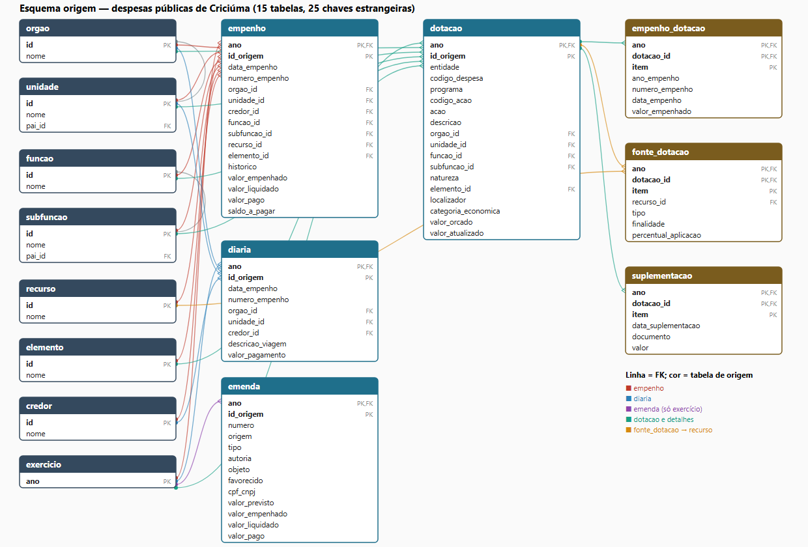

# Modelagem normalizada do banco de origem

Esta página documenta a modelagem do esquema `origem` (issue #15). O DDL está em `sql/origem.sql`, e a criação no Supabase está em [Banco de origem](banco.md).

## Diagrama

Cada linha é uma chave estrangeira, com a cor da tabela que a declara. O esquema tem 15 tabelas, todas com chave primária, e 25 chaves estrangeiras.

## Estrutura

| Grupo | Tabelas | Papel |
| --- | --- | --- |
| Dimensões | `exercicio`, `orgao`, `unidade`, `funcao`, `subfuncao`, `recurso`, `elemento`, `credor` | Domínios com código e nome, sem repetição de texto. |
| Registros | `empenho`, `diaria`, `emenda`, `dotacao` | Listagens do portal, uma linha por ocorrência. |
| Detalhes da dotação | `empenho_dotacao`, `fonte_dotacao`, `suplementacao` | Itens filhos de `dotacao`. |

## Decisões de normalização

1. **Dimensões extraídas dos textos.** Nos arquivos do portal, órgão, unidade, função, subfunção, recurso, elemento e credor aparecem como texto repetido em cada linha. Cada um virou uma tabela com `id` e `nome`, e os registros guardam só o `id`. Isso evita variações de grafia e reduz o tamanho (o `credor` tem 4.856 nomes para 62 mil empenhos). O `UNIQUE (nome)` impede dois códigos para o mesmo nome.
2. **Dependências transitivas eliminadas (3FN).** O nome do órgão depende do `orgao_id`, e não do empenho, então fica em `orgao`. O mesmo vale para as demais dimensões.
3. **Hierarquias garantidas por chave composta.** `unidade` pertence a um `orgao`, e `subfuncao` pertence a uma `funcao`. Cada uma expõe `UNIQUE (id, pai_id)`, e os registros referenciam o par `(unidade_id, orgao_id)` ou `(subfuncao_id, funcao_id)`. Assim, um empenho não pode apontar para a unidade de outro órgão, nem para a subfunção de outra função.
4. **Chaves naturais do portal.** `empenho`, `diaria` e `emenda` usam `(ano, id_origem)`. O identificador do portal só é único dentro do exercício, e a chave permite recarregar sem duplicar. Todas referenciam `exercicio`.
5. **Chave derivada para `dotacao`.** O portal não informa identificador, então o `id_origem` é um hash SHA-256 do registro normalizado. Entidade e código de despesa sozinhos podem se repetir com conteúdo distinto. Foram removidos 35 registros repetidos de dotação na limpeza.
6. **Detalhes como entidades fracas.** `empenho_dotacao`, `fonte_dotacao` e `suplementacao` usam `(ano, dotacao_id, item)` e referenciam `dotacao(ano, id_origem)`. Os itens ficam em tabelas próprias porque cada dotação tem vários (relação 1:N). Colunas multivaloradas na própria `dotacao` violariam a 1FN.
7. **`empenho_dotacao` sem chave estrangeira para `empenho`.** É uma listagem separada da geral, e as duas fontes devem ser analisadas separadamente (veja [Validação](validacao.md)). Por isso `ano_empenho` e `numero_empenho` ficam como atributos, sem restrição de integridade.
8. **`emenda` isolada.** Só referencia `exercicio`. Favorecido e `cpf_cnpj` ficam como atributos da emenda, sem tabela própria, porque são só 40 registros. A restrição `CHECK` aceita CPF (11 dígitos) ou CNPJ (14). Na cópia pública o campo fica vazio.
9. **Tipos numéricos.** Valores monetários usam `NUMERIC(18,2)`, sem erro de arredondamento de ponto flutuante. Datas usam `DATE`.
10. **Desnormalização mantida de propósito.** `empenho` guarda `valor_empenhado`, `valor_liquidado`, `valor_pago` e `saldo_a_pagar`, embora o saldo seja derivável. O portal os publica juntos, e a camada de origem deve refletir a fonte. Cálculos derivados ficam para as camadas Silver e Gold.
